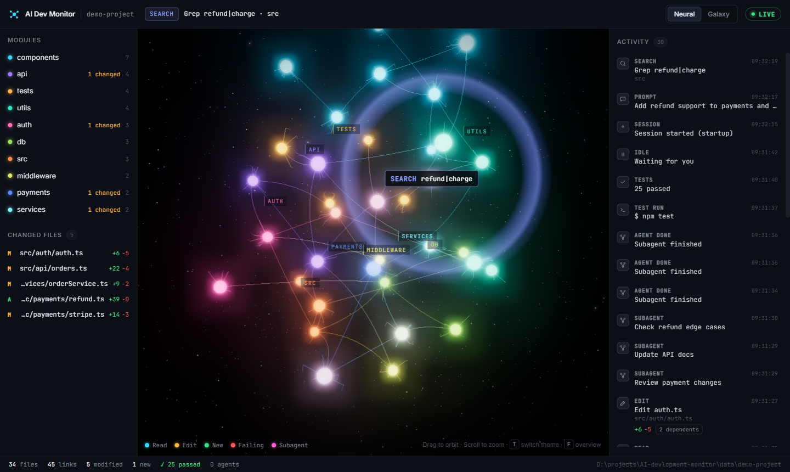
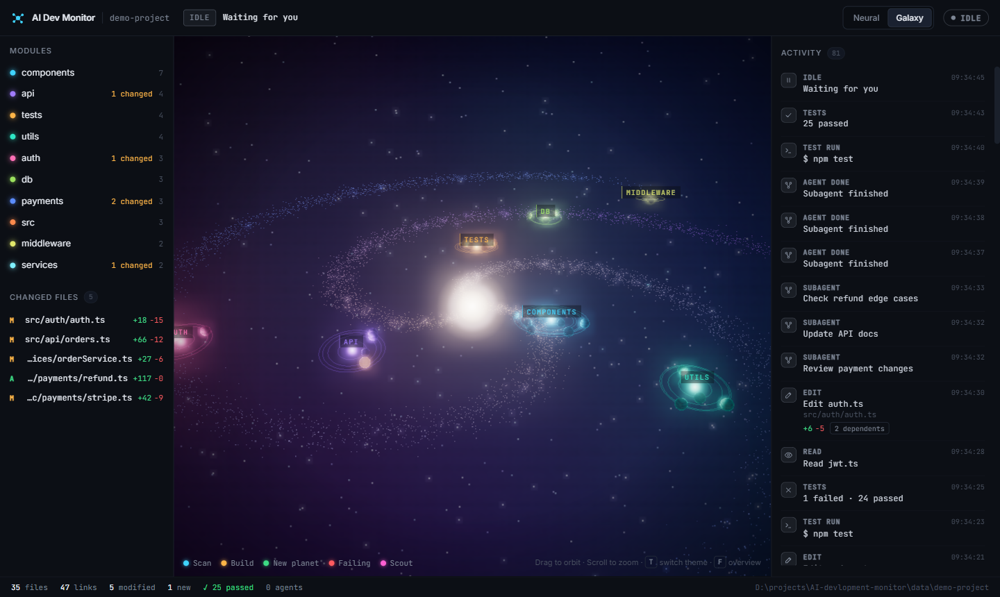
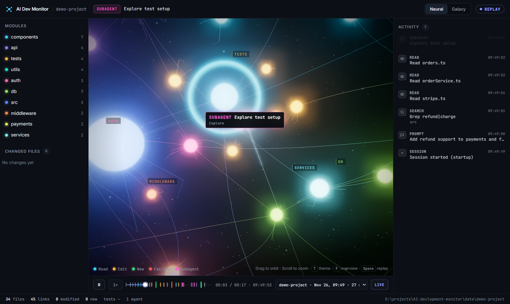

# AI Dev Monitor

Live 3D view of what Claude Code is doing in your project. Every Read, Edit, new file,
test run and subagent shows up as an animation, in one of two themes:

| Neural | Galaxy |
|---|---|
|  |  |

- **Neural**: files are neurons and imports are connections. An edit sends pulses to every file that depends on it, so you can see the impact of a change.
- **Galaxy**: modules are star systems and files are planets. Claude is a ship that scans (Read), builds (Edit) and forms new planets (Write).

Switch themes with the toggle in the top bar or press `T`. Press `F` to go back to the overview, and double-click a node to focus it.

## Session replay



The bar under the 3D view replays any recorded session:

- Pick a session from the dropdown. Sessions come from the event log and are labelled with project, start time, event count and first prompt.
- Use ▶/⏸ (or `Space`) to play and pause, and `1×`/`2×`/`4×`/`8×` to change speed. Drag the track or press `←`/`→` (±5 s) to seek.
- Markers on the track are coloured by event kind. Tall markers are test results and new files. Hover the track to see what happened at that moment.
- Idle gaps longer than 3 s are compressed, so a long session plays back quickly.
- Seeking rebuilds the exact state at that moment: changed files, new files, failing tests and the 3D colours. Files created during the session are hidden until their create event.
- Live events that arrive during a replay are counted on the button (`LIVE · 3 new`). Click **LIVE** (or press `Esc`) to return to the live view.

## Quick start

```bash
npm install
npm start            # opens the monitor on http://localhost:7777
npm run demo         # in a second terminal: plays a scripted session, no Claude needed
```

## Connect Claude Code

The monitor gets its events from Claude Code hooks. To install them:

```bash
npm run hooks:install                            # all projects  (~/.claude/settings.json)
node scripts/install-hooks.js --project D:/my-app   # one project (.claude/settings.local.json)
npm run hooks:uninstall                          # remove them again
```

The installer writes a `.bak` backup before it changes the settings file. Start a new Claude Code session after installing.

Keep `npm start` running. The monitor follows whichever project Claude is working in.
Each hook is a small Node script, [hooks/send-event.js](hooks/send-event.js). It has a timeout of under a second, always exits 0 and prints nothing, so Claude is never slowed down or blocked, even when the monitor is off.

## VS Code extension

```bash
npm run ext:install   # bundles server + web into a .vsix (dist/) and installs it with the code CLI
```

Once installed, the extension starts the monitor server inside VS Code, so you don't need `npm start`. If a monitor is already running on the port, it reuses that one, and if that server stops, it takes over the port.

- **Status bar**: shows what Claude is doing right now, for example `Edit users.ts` or `Tests: 1 failed`. Click it to open the 3D panel beside your editor.
- **Commands**: `AI Dev Monitor: Open Monitor`, `Show This Workspace`, `Open in Browser`.
- **Settings**: `aiDevMonitor.port` (default 7777) and `aiDevMonitor.autoStart` (default on).

## Several projects in parallel

The server keeps a separate live state for every project: graph, events, changed files, tests and agents. Each hook event goes to its project through the Claude session it belongs to, so two or three Claude sessions working on different projects never mix.

- **VS Code**: every window's panel (`AI Monitor · <folder>`) and status bar show only that window's workspace. With `aiDevMonitor.autoOpen` on (the default), the panel opens without taking focus, and only in the window whose folder the Claude session started in.
- **Browser**: open `http://localhost:7777/?project=D:/path/to/project` to pin a tab to one project. Plain `http://localhost:7777` follows whichever project Claude was most recently started in.
- **Nested folders**: a folder inside another project, like `data/demo-project` here, counts as its own project when you open it as a workspace or start a Claude session in it.
- `GET /api/projects` lists the projects the server is tracking. It keeps up to 12 and drops the least recently active ones that nobody is viewing.

## How it works

```
Claude Code hooks ──POST /event──▶ server (Node, 127.0.0.1:7777) ──WebSocket──▶ browser (Three.js)
                                     │  scans files + imports
                                     └─ data/events.jsonl (event log)
```

| Hook | Event | Neural | Galaxy |
|---|---|---|---|
| PreToolUse `Read` | read | neuron glows cyan, scan rings | ship flies over, scan beam |
| PreToolUse `Edit`/`MultiEdit` | edit | amber pulses to dependents | construction rings, hyperlanes to dependents |
| PreToolUse `Write` (new file) | create | neuron is born with a burst | accretion disk forms a planet |
| `Grep`/`Glob` | search | radar ring | radar ring |
| `Bash` + PostToolUse | bash / test_result | wave through the network, failing paths turn red | pulsar beam, failing planets turn red |
| `Task`/`Agent` + SubagentStop | agent_start / stop | coloured scout orbs | scout ships with trails |
| Stop | idle | camera returns to overview | ship returns to orbit |

Test output is parsed for Jest, Vitest, pytest, Mocha and similar runners (for example `24 passed`, `1 failed`, `FAIL path`).

## Files

- [server/index.js](server/index.js): HTTP + WebSocket server, event store, file watcher
- [server/scanner.js](server/scanner.js): file graph and import resolution (JS/TS, Python, CSS)
- [server/normalize.js](server/normalize.js): turns raw hook payloads into visual events
- [web/engine.js](web/engine.js): renderer, bloom, camera follow, callouts, theme switching
- [web/themes/neural.js](web/themes/neural.js), [web/themes/galaxy.js](web/themes/galaxy.js): the two themes
- [web/app.js](web/app.js): panels, activity feed, WebSocket client

Set `MONITOR_PORT` to use a port other than 7777. To start the monitor on a specific project, use `npm start -- --project D:/my-app`.

## Next steps

- Package as a VS Code extension (webview panel) and a Tauri desktop app
- Timeline scrubber to replay a session from `data/events.jsonl`
- Attribute tool calls to their subagent once hooks expose an agent id
