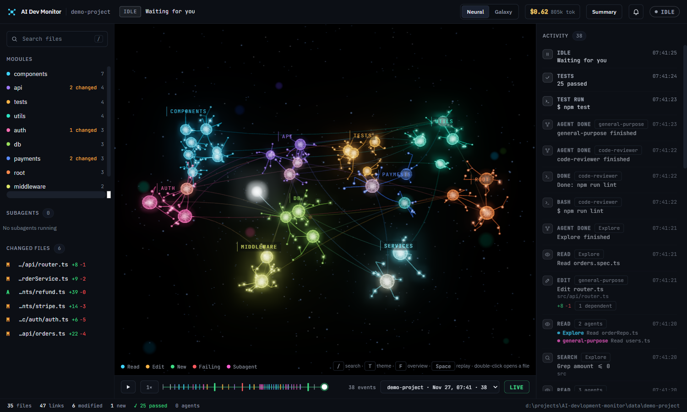
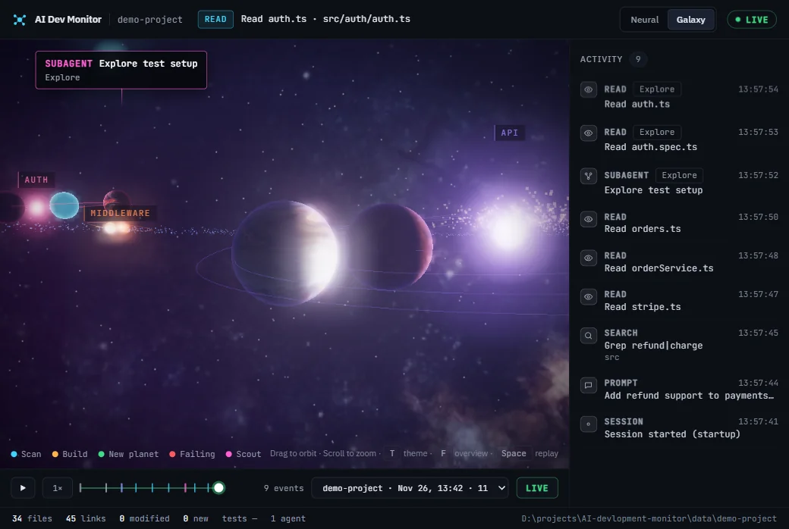
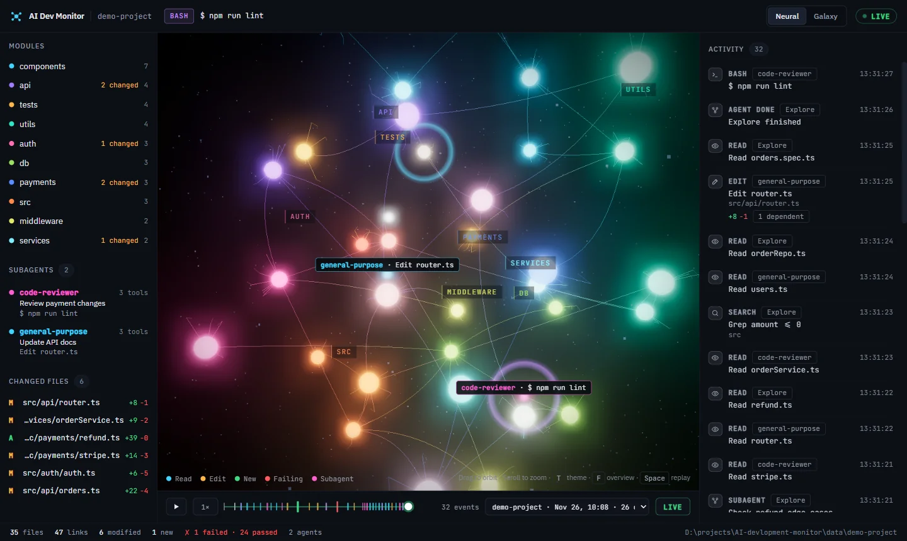

# AI Dev Monitor

**See what Claude Code is doing, live.** Your project becomes a 3D map, and as Claude works you can watch it read files, edit them, run tests and start subagents.

## Features

- **Two 3D themes.**
  - **Neural:** every file is a neuron, and imports are the connections between them.
  - **Galaxy:** every module is a solar system, and every file is a planet in it.
  - Press `T` to switch between them.
- **Live activity:**
  - A file glows when Claude reads it, and pulses when Claude edits it.
  - A new file appears when Claude creates it.
  - Files whose tests fail turn red.
  - A feed on the right lists every step.
- **Subagents.**
  - Each subagent Claude starts has its own colour and its own scout in the 3D view.
  - Each one is matched to the task it was given, even when ten run at the same time.
- **Needs-you alerts.** You get a desktop notification and a sound when Claude:
  - asks for permission
  - asks you a question
  - finishes a long turn
- **Session summary.** When a long turn ends, a card shows:
  - the files Claude read, edited and created
  - lines added and removed, and the last test result
  - the modules it worked in
- **Tokens and cost.**
  - The top bar shows the tokens the session has used, and what they would cost at Anthropic API prices.
  - The summary breaks this down per model and per subagent.
- **Status bar.** Claude's current action (Read, Edit, Testing…) is always visible in the status bar. Click it to open the monitor.
- **Find a file and open it.**
  - Press `/` to search the map.
  - Click a file to fly to it, or double-click it to open it in the editor.
- **Replay.** Scrub through any earlier session on the timeline.

## Getting started

1. Install the extension.
2. Click **Install hooks** when the extension asks.
   - The extension then adds hooks to `~/.claude/settings.json`, so that Claude Code reports each step to the monitor.
   - It keeps a backup of that file in `settings.json.bak`.
   - You can also run **AI Dev Monitor: Install Claude Code Hooks** from the Command Palette at any time.
3. Start a new Claude Code session, in VS Code or in a terminal. The monitor opens beside your editor.

Everything runs on your machine:
- The monitor is a small server on `127.0.0.1:7777`, and nothing is sent anywhere else.
- Token counts are read from the transcripts Claude Code already writes under `~/.claude/projects/`. The monitor only reads them.

## Commands

| Command | What it does |
|---|---|
| AI Dev Monitor: Open Monitor | Opens the 3D view beside the editor |
| AI Dev Monitor: Show This Workspace | Switches the view to the folder open in this window |
| AI Dev Monitor: Open in Browser | Opens the same view in your browser |
| AI Dev Monitor: Install Claude Code Hooks | Adds the hooks to `~/.claude/settings.json` |
| AI Dev Monitor: Remove Claude Code Hooks | Removes them again, and leaves everything else in the file as it is |

## Settings

| Setting | Default | |
|---|---|---|
| `aiDevMonitor.port` | `7777` | Port of the local monitor. The hooks send to this port. |
| `aiDevMonitor.quality` | `balanced` | `low` for older laptops or when on battery, `high` for a strong GPU |
| `aiDevMonitor.autoOpen` | `true` | Opens the panel when a Claude Code session starts in this workspace |
| `aiDevMonitor.autoStart` | `true` | Starts the monitor when VS Code starts, so events are captured while the panel is closed |

## Claude Code in a terminal

The hooks work for `claude` in any terminal too. While VS Code is open, the extension runs the monitor for both.

To use the monitor without VS Code, or to check your setup, use the `adm` command from the [repository](https://github.com/selvadev-01/AI-devlopment-monitor):
- `adm doctor` checks hooks, monitor, tokens, subagents and alerts.
- `adm` starts the monitor and opens it in the browser.

## Notes

- The cost is an estimate at Anthropic API list prices. Claude Pro and Max plans are not billed per token.
- Several projects can be watched in parallel. Each VS Code window shows its own project.

Source code, issues and the full documentation: [github.com/selvadev-01/AI-devlopment-monitor](https://github.com/selvadev-01/AI-devlopment-monitor). MIT licensed.
